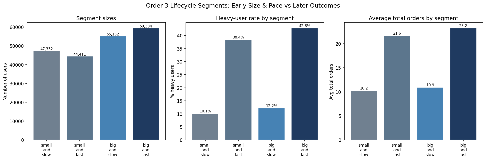

# Among 206,209 repeat Instacart customers, how quickly someone places their 2nd and 3rd orders separates future heavy users far more than what is in their first basket (AUC 0.76 vs 0.57), though part of that link is built into how 'heavy' is defined.

## Business Question

Among repeat grocery customers, which early behaviours (first 3 orders) are
associated with becoming a heavy, regular customer later, and which nudges
would be worth A/B testing to increase repeat ordering?

## Data Source

**Instacart Online Grocery Shopping Dataset** (Kaggle, "Instacart Market Basket Analysis"):
3,421,083 orders from 206,209 users, 49,688 products across 134
aisles and 21 departments.

> Note: Read the dataset's licence and terms on Kaggle before publishing anything derived from it. Raw data is gitignored.

## Setup

1. **Python version**: Python 3.10+ (tested on Python 3.12).
2. **Download dataset**: Download the CSV files from Kaggle's "Instacart Market Basket Analysis" competition page.
3. **Place files**: Ensure the 6 raw CSV files are placed in `data/raw/`:
   - `orders.csv`
   - `order_products__prior.csv`
   - `order_products__train.csv`
   - `products.csv`
   - `aisles.csv`
   - `departments.csv`
4. **Install dependencies**:
   ```bash
   pip install -r requirements.txt
   ```

## Key Findings

- **Pacing dominates basket features**: Early return cadence shows a medium association with becoming a heavy user (Cohen's d about 0.72–0.76; gap model AUC 0.76).
- **Basket-composition effects are negligible to small**: Every early basket feature has a Cohen's d < 0.20 and modest odds ratios (1.03–1.14; lead model AUC 0.57).
- **Circularity in pacing**: The strong link between early gaps and total orders is likely partly mechanical, assuming comparable observation windows, because order accumulation is mechanically linked, if observation windows are comparable.
- **Pace segments differ most**: At the order-3 decision point, fast vs slow return segments differ by 28–32 percentage points in heavy-user rate (e.g. 42.8% vs 12.2%), whereas basket-size segments differ by only 2–4 percentage points (e.g. 42.8% vs 38.4%).
- **Stable cadence overlap**: Across 6, 7, and 8-day thresholds, 56–59% of fast-cadence users qualify as heavy users, while 41–44% do not.

## Key Visualizations

### Odds Ratios for Heavy-User Status (Lead Model Without Gaps)


### Lifecycle Segments (Defined at Order 3 Decision Point)


## Method

- **Leakage prevention**: Features from orders 1–3 only; outcomes from orders 4+ only.
- **Primary outcome**: "Heavy user" = top quartile by total orders: 20+ orders (about 26.2% of users).
- **Secondary outcome**: "Fast cadence" = median gap in orders 4+ <= 7 days.
- **Collinearity control**: `first_order_size` and `n_aisles_order1` dropped; all VIFs strictly < 2.5 (true maximum VIF across both models = 2.28).
- **Lead model (without gaps)**: Standardized logistic regression; headline cross-validated AUC: **0.568** (~0.57).
- **Secondary model (with gaps)**: Pacing adds discrimination (AUC 0.756), but is partly circular with total orders.
- **Robustness**: Sensitivity checks across top 20% and 30% volume cutoffs, and 6, 7, and 8-day cadence thresholds.

## How to Run

Run the entire pipeline with a single command:

```bash
# Windows PowerShell (no make.exe needed):
python run.py
# or
.\run.ps1

# Unix / macOS / environments with GNU make:
make run
```

Alternatively, step by step:
```bash
python -m pytest tests/ -v              # Run leakage & integrity tests
python src/generate_phase0_results.py   # Data reality check -> results.json
python src/run_pipeline.py              # SQL pipeline -> parquet
python src/analysis.py                  # Statistical analysis -> charts + results.json
python src/generate_docs.py             # Memo, README, CV bullet from results.json
```

## Limitations

1. **Survivorship bias (critical)**: Every user has >= 4 orders. Customers who placed fewer than 4 orders are completely absent.
2. **Total orders capped at 100**: Order sequence is truncated at 100 orders, compressing the extreme power-user tail.
3. **Median gap capped at 30 days**: `days_since_prior_order` is right-censored at 30 (19.2x spike at 30 vs 29 days).
4. **No prices or revenue**: Basket size is item count, not currency value.
5. **No user demographics**: No age, location, device, or acquisition channel.
6. **Descriptive only**: All associations are observational. We never claim any behavior causes retention.
7. **Single retailer, single period**: Findings may not generalize to other grocery environments.

## Project Structure

```
├── config.yaml              # All tuneable parameters (seeds, thresholds, brackets)
├── data/raw/                 # Raw CSVs (gitignored)
├── data/processed/           # Parquet exports (gitignored)
├── sql/                      # DuckDB SQL pipeline (staging -> features -> outcomes)
├── src/
│   ├── generate_phase0_results.py
│   ├── run_pipeline.py
│   ├── analysis.py
│   └── generate_docs.py
├── tests/                    # pytest: leakage, integrity, outcome definitions
├── results/
│   ├── results.json          # Single-source-of-truth computed metrics
│   └── figures/              # Publication charts
├── docs/
│   ├── analysis_plan.md
│   ├── memo.md
│   ├── nudges.md
│   ├── metrics_tree.md
│   ├── cv_bullet.md
│   └── INTERVIEW_NOTES.md
├── notebooks/analysis.ipynb
├── run.py                    # Cross-platform single-command runner
├── run.ps1                   # PowerShell runner
├── Makefile
└── requirements.txt
```
