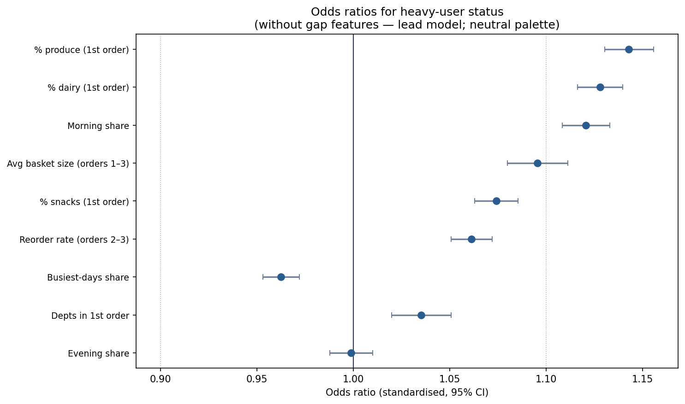

# Among 206,209 repeat Instacart customers, early return cadence is the dominant differentiator of heavy users, while early basket-composition effects are small (all Cohen's d < 0.20; lead basket OR 1.14 for produce share (1st order)).

## Business Question

Among repeat grocery customers, which early behaviours (first 3 orders) are
associated with becoming a heavy, regular customer later, and which nudges
would be worth A/B testing to increase repeat ordering?

## Data Source

**Instacart Online Grocery Shopping Dataset** (Kaggle, "Instacart Market Basket Analysis"):
3,421,083 orders from 206,209 users, 49,688 products across 134
aisles and 21 departments.

> ⚠️ Read the dataset's licence/terms on Kaggle before publishing anything derived from it.
> Raw data is gitignored and must never be committed.

## Method

- **Leakage prevention**: Features from orders 1–3 only; outcomes from orders 4+ only.
- **Primary outcome**: "Heavy user" = top quartile by total orders (≥ 20 orders).
- **Secondary outcome**: "Fast cadence" = median gap in orders 4+ ≤ 7 days.
- **Collinearity control**: `first_order_size` and `n_aisles_order1` dropped; all VIFs strictly < 2.5.
- **Lead model (without gaps)**: Standardized logistic regression; headline cross-validated AUC: **0.568** ($\approx 0.57$).
- **Secondary model (with gaps)**: Pacing adds discrimination (AUC 0.756), but is partly circular with total orders.
- **Robustness**: Sensitivity checks across top 20% and 30% volume cutoffs, and 6, 7, and 8-day cadence thresholds.
- **Visualizations**: All figures rendered with a neutral palette (no red highlighting).

## Key Chart



## How to Run

Run the entire pipeline with a single command:

```bash
# Windows PowerShell (no make.exe needed):
python run.py
# or
.\run.ps1

# Unix / macOS / environments with GNU make:
make run
```

Alternatively, step by step:
```bash
python -m pytest tests/ -v              # Run leakage & integrity tests
python src/generate_phase0_results.py   # Data reality check → results.json
python src/run_pipeline.py              # SQL pipeline → parquet
python src/analysis.py                  # Statistical analysis → charts + results.json
python src/generate_docs.py             # Memo, README, CV bullet from results.json
```

## Limitations

1. **Survivorship bias** (critical): Every user has ≥ 4 orders. Customers who churned after 1–2 orders are completely absent.
2. **Total orders capped at 100**: Order sequence is truncated at 100 orders, compressing the extreme power-user tail.
3. **Median gap capped at 30 days**: `days_since_prior_order` is right-censored at 30 (19.2× spike at 30 vs 29 days).
4. **No prices or revenue**: Basket size is item count, not currency value.
5. **No user demographics**: No age, location, device, or acquisition channel.
6. **Descriptive only**: All associations are observational. We never claim any behavior causes retention.
7. **Single retailer, single period**: Findings may not generalize to other grocery environments.

## Project Structure

```
├── config.yaml              # All tuneable parameters (seeds, thresholds, brackets)
├── data/raw/                 # Raw CSVs (gitignored)
├── data/processed/           # Parquet exports (gitignored)
├── sql/                      # DuckDB SQL pipeline (staging → features → outcomes)
├── src/
│   ├── generate_phase0_results.py
│   ├── run_pipeline.py
│   ├── analysis.py
│   └── generate_docs.py
├── tests/                    # pytest: leakage, integrity, outcome definitions
├── results/
│   ├── results.json          # Single-source-of-truth computed metrics
│   └── figures/              # Neutral-styled publication charts
├── docs/
│   ├── analysis_plan.md
│   ├── memo.md
│   ├── nudges.md
│   ├── metrics_tree.md
│   ├── cv_bullet.md
│   └── INTERVIEW_NOTES.md
├── notebooks/analysis.ipynb
├── run.py                    # Cross-platform single-command runner
├── run.ps1                   # PowerShell runner
├── Makefile
└── requirements.txt
```
