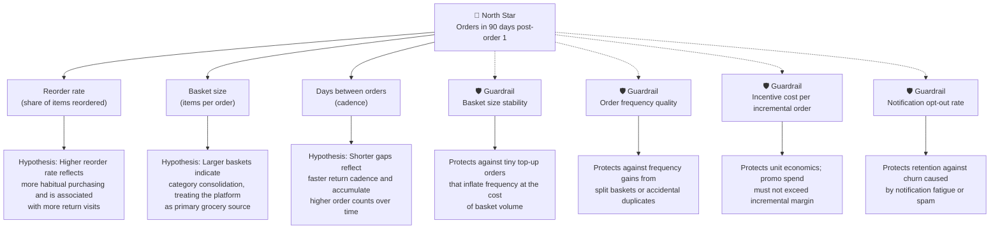

# Metrics Tree

## North Star

**Orders in the 90 days after the first order** — the primary production North Star metric tracking sustained habit formation. (In this historical dataset without calendar timestamps, this is proxied by repeat orders per user from order 4 onward).

## Input Metrics

## Guardrails

| Guardrail | What it protects against | How it is measured |
|-----------|------------------------|--------------------|
| **Basket size stability** | Nudges that drive tiny top-up orders, inflating frequency at the cost of basket value. | Relative change in basket size (item count) vs control arm. |
| **Order frequency quality** | Frequency gains that come from split baskets or accidental duplicates rather than genuine shopping trips. | Orders placed within 2 hours of a prior order; same-day order count. |
| **Incentive cost per incremental order** | Unprofitable discounts that subsidize organic returns without covering promo costs. | (Promo cost in treatment - promo cost in control) / incremental orders. |
| **Notification opt-out rate** | Excessive messaging frequency driving push notification disables or app uninstalls. | Unsubscribe / notification opt-out rate (must remain < 2%). |

## How to use this tree

1. **Track the North Star** at the cohort level after any intervention (orders in 90 days post-order 1).
2. **Diagnose** changes by looking at the input metrics: did repeat orders go
   up because of more reordering, bigger baskets, or faster cadence?
3. **Enforce guardrails**: if basket size drops, opt-outs rise, or incentive cost per incremental order exceeds unit margins, terminate the intervention early.
