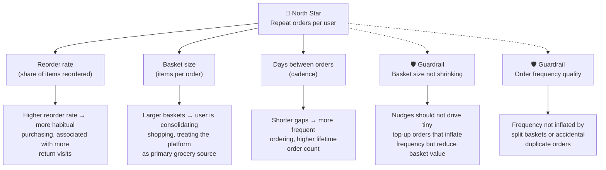

# Metrics Tree

## North Star

**Repeat orders per user** — the total number of orders a user places after
their initial purchase period.

## Input Metrics

## Guardrails

| Guardrail | What it protects against |
|-----------|------------------------|
| **Basket size not shrinking** | Nudges that drive tiny top-up orders, inflating frequency at the cost of basket value. |
| **Order frequency quality** | Frequency gains that come from split baskets rather than genuine additional shopping trips. |

## How to use this tree

1. **Track the North Star** at the cohort level after any intervention.
2. **Diagnose** changes by looking at the input metrics: did repeat orders go
   up because of more reordering, bigger baskets, or faster cadence?
3. **Watch guardrails**: if basket size drops or order frequency rises without
   proportional basket sizes, the nudge may be gaming the metric.
